# Franz Tausch — Batch tests & answers in the Google Doc (23 Aug 2026) — English translation

**Source:** Gmail thread `Fwd: Follow-up on the Innowise x KIMI-Plus Meeting (26.05.2026)`, forwarded by Darya Nestserava on 24 Aug 2026 to Viktar Kruhlikau. German original: `docs/16-additional-feedback-from-franz/franz-email-2026-08-23.md`.

**From:** Franz Tausch <franz.tausch@kimi-plus.at>
**Date:** Sunday, 23 August 2026, 22:22
**To:** Darya Nestserava <darya.nestserava@innowise.com>
**Cc:** Michael Bortnik, Lizaveta Akulenka, Susanne Lauer <susanne.lauer@kimi-plus.at>
**Subject:** AW: Follow-up on the Innowise x KIMI-Plus Meeting (26.05.2026)

> Attachments (screenshots): see `attachments/` — `image001.png` … `image028.png`.

---

## 1. New message from Franz (23 Aug 2026)

Dear Ms Nestserava,

I have entered my answers to the questions in the Google Doc.

Example.

My first batch tests:

The programs run quite well, but I suspect that something is wrong with the file directory, or that I put the import files into the wrong directory??!

Please check and give me feedback, and also whether we can have an alignment meeting.

Thank you and kind regards

FranZ

### 1.1. Batch test log (screenshots with Franz's comments)

**NOK** – the records do not match the input file, 29 vs 32 – which file is actually being used?

**OK** – display of what was actually imported …

**OK**

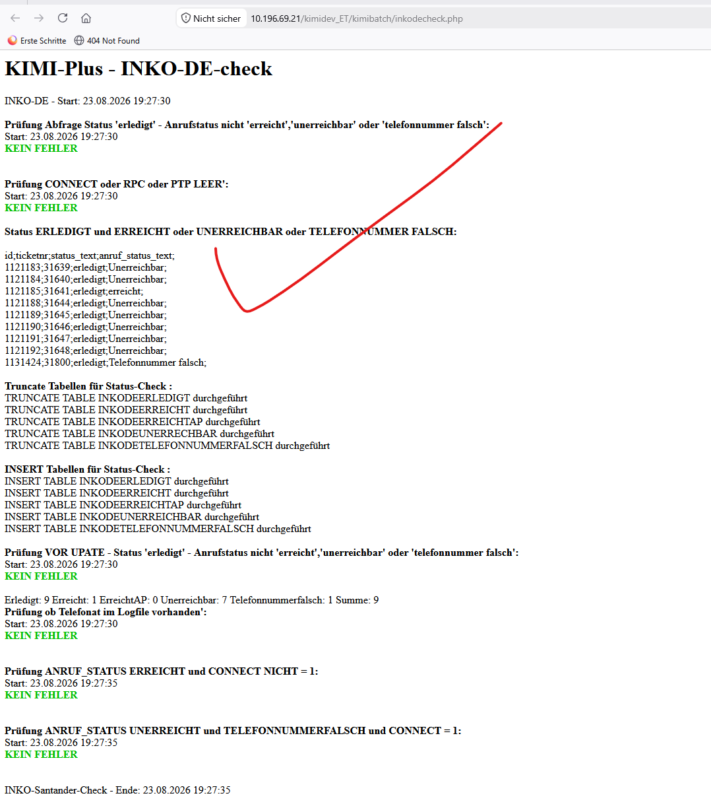

**OK**

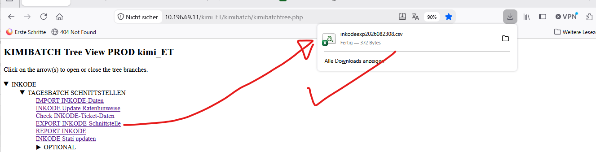

**OK**

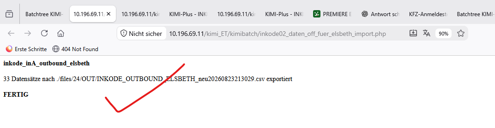

**OK**

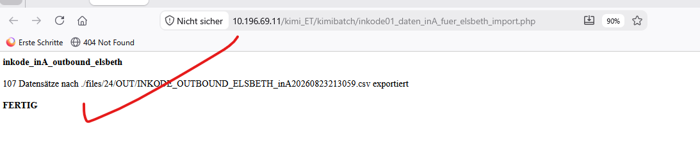

**OK**

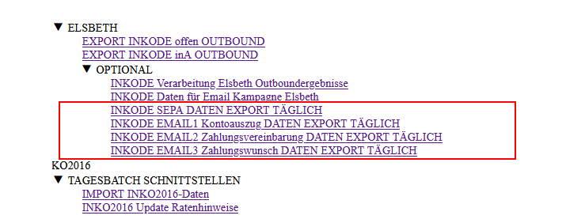

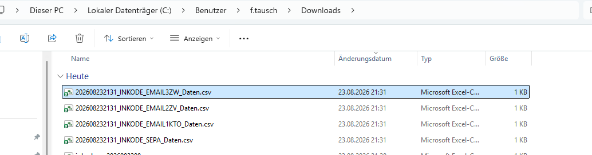

**NOK** – imported 4 records instead of 46

Input file

**OK**

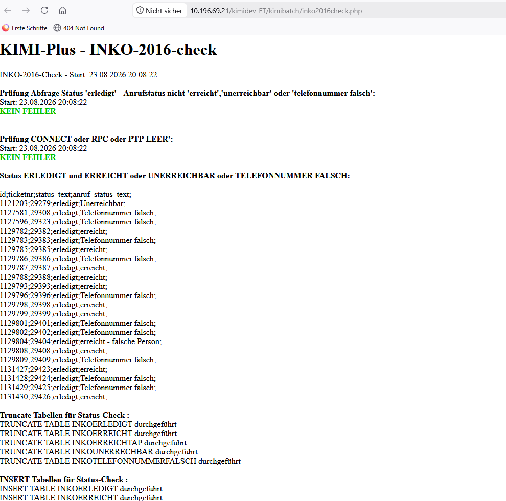

**OK**

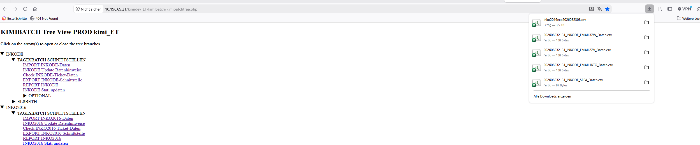

**OK**

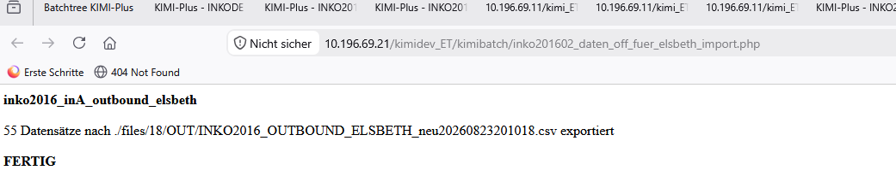

**OK**

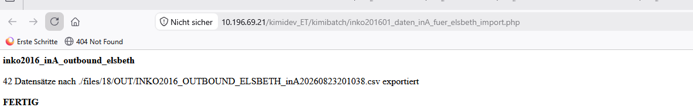

**OK(O)** – here too the actual import does not match the input file?!? ACTUAL: 28 vs EXPECTED 16?!?

---

## 2. Previous message from Franz (19 Aug 2026 13:56)

Dear Ms Nestserava,

thank you for your message. I am fine, I hope you are too.

I have done the first 2 test steps. The goal was to check the test environment and the data.

Under Firefox I cannot get in – the session-cookie problem still seems to be present here. So I tested with the alternative Cliq instead.

That is why it is important to me that, before the tests start, we clarify the test environment together with Viktor. Also because of the open questions about the database state, and because the list in the Google Doc is very long, it would be better if we aligned directly.

I therefore ask for a proposed meeting date. Always in the afternoon, please – THANK YOU.

Until then I will work through the questions in the Google Doc and continue the tests.

Thank you in advance.

I look forward to your feedback.

Kind regards

FranZ

**#1 Session cookie?!? In Firefox I cannot get through to the search mask.**

ACTUAL in Firefox – I cannot get to the campaign selection

EXPECTED

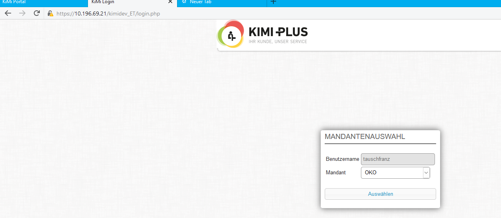

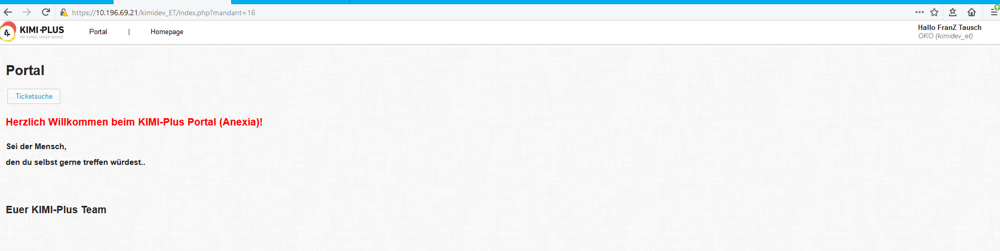

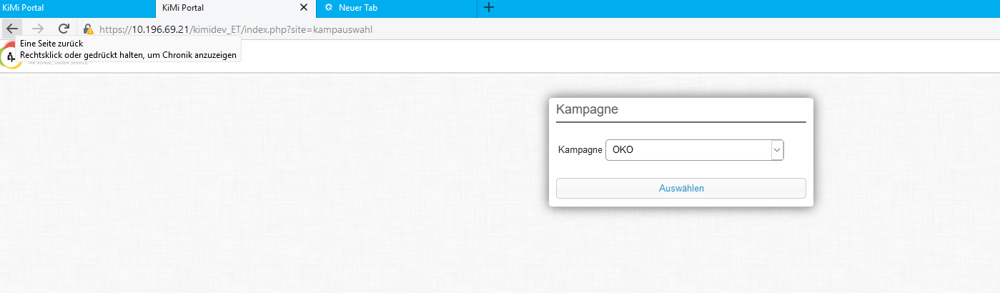

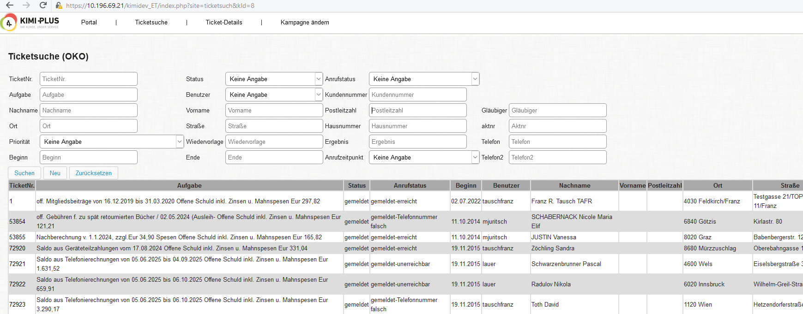

---

## 3. Quoted context: message from Darya (18 Aug 2026 12:34)

Good day, Mr Tausch!

I hope your week is going wonderfully so far! Viktor sent me an update, which I am forwarding to you:

---

Good afternoon, Franz!

I updated the code on the test site, and when over the test scenarios that you provided.

It appeared that the code that was deployed to test server significantly diverged from the original code you sent us before. And I was have to run PHP8.0 -> PHP 8.5 upgrade again which took additional efforst. But I stayed within initial estimate.

Also, it seems that the dump migration was done without the migration of database functions\procedured - I recredaed them on the test server from the previous dump.

I created list of problems in the code that I found. Some of them are pre-existing issues and some of them are fixed my me. Here is the report: https://docs.google.com/document/d/1ZvnoYLuQxBI8MtmPjtA5KHgd7YK4sGJuU2OMGXZDZHg/edit?usp=sharing

**1.** Please could you go over the test scrnarios from your side (and test if anything is wrong.) I went over the test scearios (and fixed bugs that I found), but since the database if different, i'm not 100% sure that I catched all the issues.

**2.** If you find any issues, please let us know. If all works fine - please let us know either.

See the curreltly spent time for the task vs estimated efforst in the estimate file: https://docs.google.com/spreadsheets/d/1pGXd2-RhUVA6CnJoXNFUrTcEF6-Cjz_s/edit?usp=sharing&ouid=102104514313633945938&rtpof=true&sd=true

---

I wish you a wonderful day!

---

## 4. Quoted context: Franz (14 Aug 2026 08:55)

Good day, dear Ms Nestserava,

thank you for the update. Of course I will not make any changes.

I keep my fingers crossed for a smooth and successful implementation.

We look forward to the first tests.

Kind regards

FranZ

## 5. Quoted context: Darya (13 Aug 2026 14:30)

Good day Mr Tausch,

I received feedback from Viktor:

The work on the test server is currently in progress.

We ask you not to make any changes to the system code until further notice, so that no divergence arises between the code on the test server and the code on the production server.

We will let you know as soon as testing of the updated system functions on the test server is possible on the KIMI side.

Kind regards, Darya

---

> The older thread history (4 Aug 2026 database import from Anexia, 28 Jul 2026, 20 Jul 2026 ANEXIA status of 16 Jul 2026) is already stored in `docs/14-update-from-Franz-about-the-database/01-update-from-Franz-about-the-database.md` and `docs/13-franzs-answer/franz-answer-2026-07-16.md`.
