# Franz's reported problems — batch tests of 23 Aug 2026 (action list)

Extracted from `docs/16-additional-feedback-from-franz/franz-email-2026-08-23.md` (German original) / `docs/16-additional-feedback-from-franz/franz-email-2026-08-23-en.md` (English). Screenshots live in `docs/16-additional-feedback-from-franz/attachments/`.

**Summary:** the batch programs themselves run (no PHP fatals — every screen Franz marked "OK" rendered). The three "NOK" items are all **record-count mismatches between the import result and the input file Franz prepared**, and Franz himself already suspects the cause: *"ich habe den verdacht das etwas nicht mit dem Fileverzeichnis stimmt bzw. Ich die Importdateien auf das falschen Verzeichnis gelegte haben??!"* ("I suspect that something is wrong with the file directory, or that I put the import files into the wrong directory").

---

## P1 — INKODE import: 29 records imported vs 32 in the input file

- **Franz's verdict:** *"NOK – Datensätze passen nicht mit der Eingabedatei zusammen 29 zu 32 – welches File wird da wirklich verwendet"* ("which file is actually being used?").
- **Evidence:** 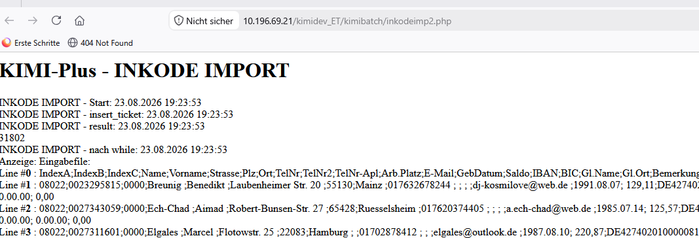 — `http://10.196.69.21/kimidev_ET/kimibatch/inkodeimp2.php`, start `23.08.2026 19:23:53`, last ticket id `31802`. Input file as Franz sees it: 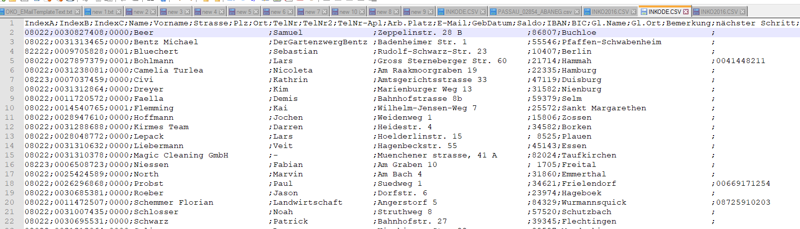. Resulting ticket list: 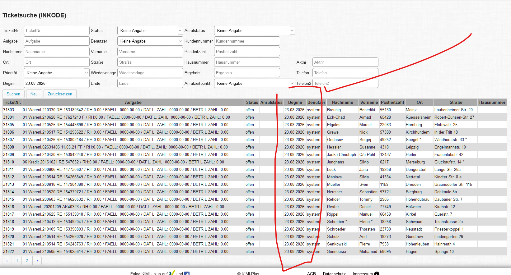.
- **Script and input path:** `src-dev/original-src/web/htdocs/kimidev_ET/kimibatch/inkodeimp2.php:88` — `$lines = file('files/INKODE.CSV');`.

## P2 — INKO2016 import: 4 records imported instead of 46

- **Franz's verdict:** *"NOK – Import 4 Datensätze anstelle 46"*.
- **Evidence:** 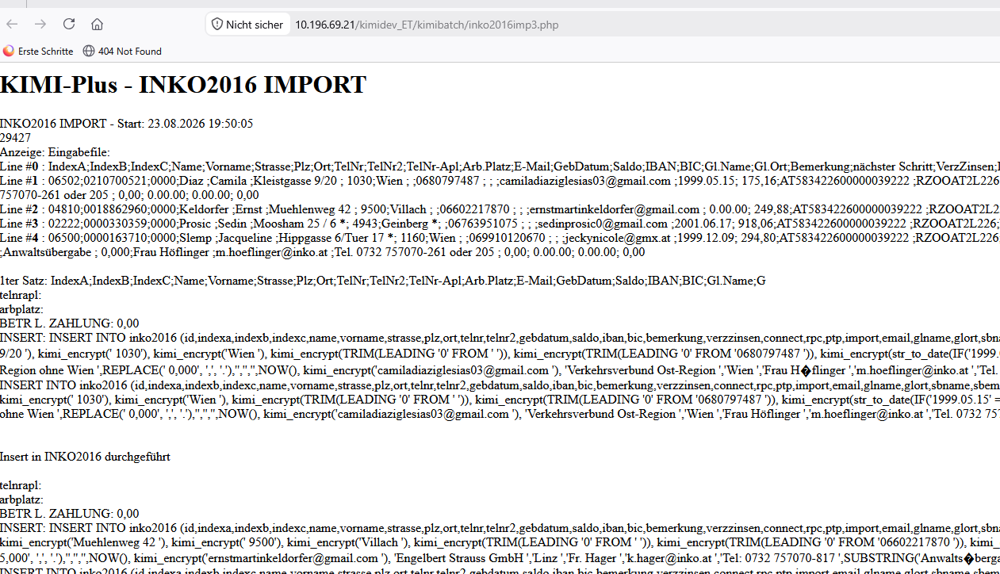 — `http://10.196.69.21/kimidev_ET/kimibatch/inko2016imp3.php`, start `23.08.2026 19:50:05`. The page's own "Anzeige: Eingabefile:" dump lists only `Line #0` (the `IndexA;IndexB;…` header) plus `Line #1`–`Line #4`. Input file as Franz sees it: 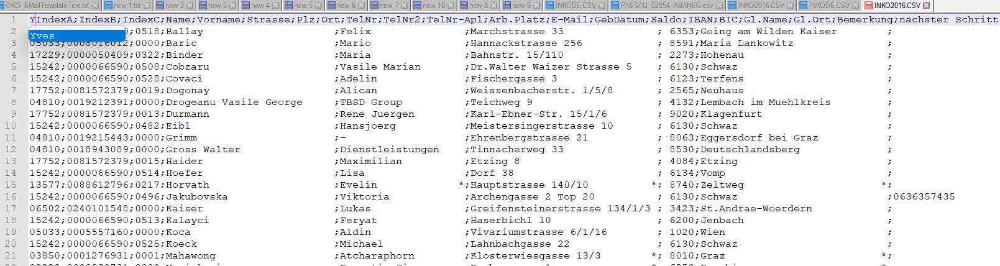.
- **This is the strongest single piece of evidence.** `src-dev/original-src/web/htdocs/kimidev_ET/kimibatch/inko2016imp3.php:76-84` reads `$lines = file('files/INKO2016.CSV');` and then echoes **every** element of `$lines`. Only 5 lines were echoed, so the file the script actually read contained 5 lines — it was **not** the 46-row file Franz prepared. The import is faithfully processing a different (stale/short) file.

## P3 — OKO / POS30 import: 28 records imported vs 16 expected

- **Franz's verdict:** *"auch hier stimmt der tatsächliche Import nicht mit der Eingabedatei zusammen?!? IST: 28 zu SOLL 16?!?"* ("here too the actual import does not match the input file: ACTUAL 28 vs EXPECTED 16").
- **Evidence:** 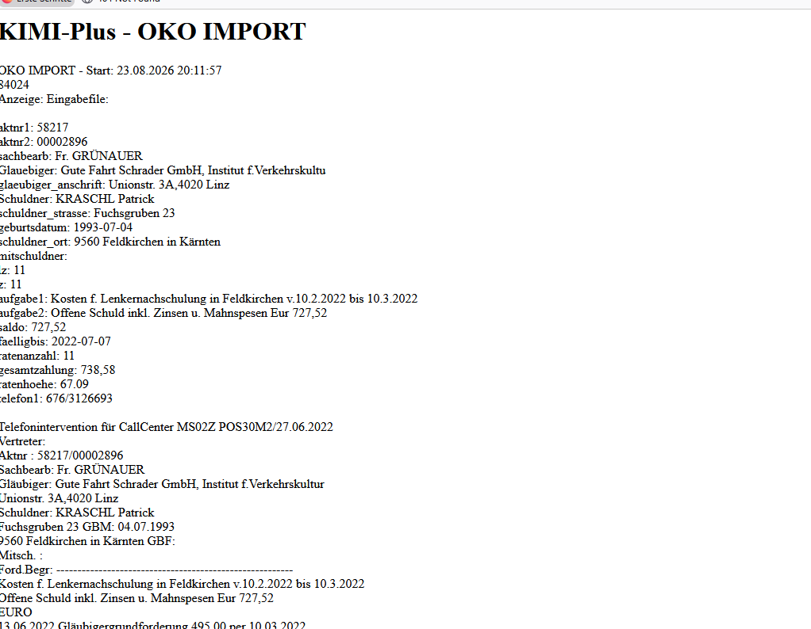 — start `23.08.2026 20:11:57`. Resulting ticket list: 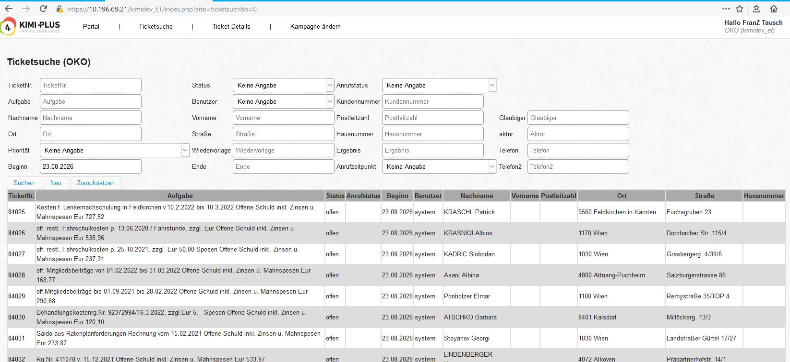. Input file: 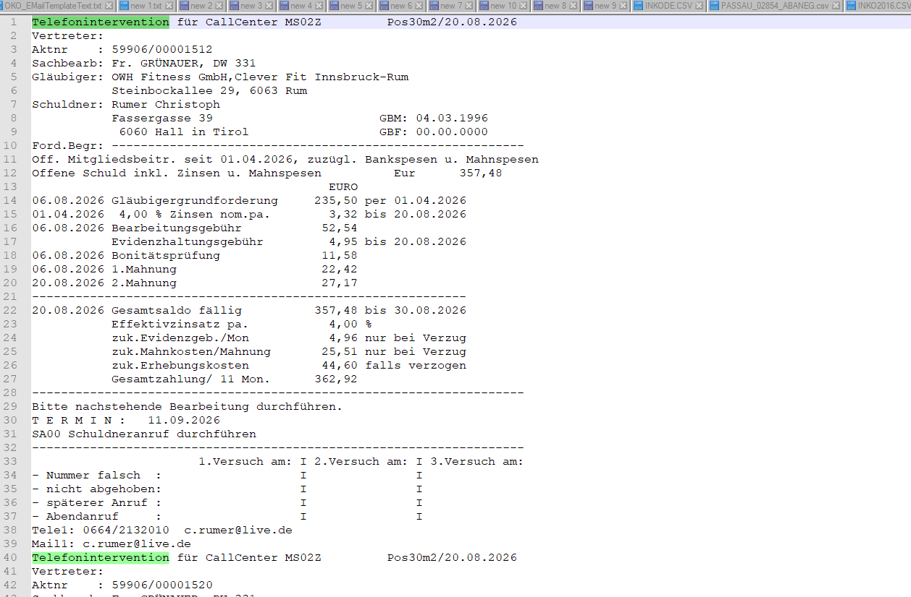.
- **Script and input path:** `src-dev/original-src/web/htdocs/kimidev_ET/kimibatch/okoimp.php:69` — `$lines = file('files/pos30cc.txt');`.
- Note the direction: here **more** records were imported than expected (28 > 16), which again points at a different file being read rather than at rows being skipped.

## P4 — Root cause candidate: the import files were uploaded into the *backup* tree, not the live one

- **Where P4 comes from — Franz's own words.** P4 is not our inference: Franz states the suspicion himself, in the body of his message of 23 Aug 2026 (see `docs/16-additional-feedback-from-franz/franz-email-2026-08-23.md:26-28`):

  > Meine ersten Batch-Tests:
  >
  > Die Programme laufen ganz gut, nur habe ich den verdacht das etwas nicht mit dem **Fileverzeichnis** stimmt bzw. **Ich die Importdateien auf das falschen Verzeichnis gelegte** haben??"!

  ("My first batch tests: the programs run quite well, but I suspect that something is wrong with the **file directory**, or that **I put the import files into the wrong directory**??!")

  He repeats the same doubt as the closing question of his P1 verdict, at `docs/16-additional-feedback-from-franz/franz-email-2026-08-23.md:40`:

  > **NOK** – Datensätze passen nicht mit der Eingabedatei zusammen 29 zu 32 – **welches File wird da wirklich verwendetn**

  ("the records do not match the input file, 29 vs 32 – **which file is actually being used?**")

- **Evidence:** 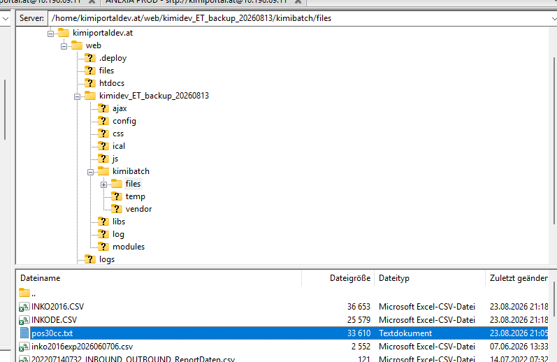. Franz's SFTP client is in `/home/kimiportaldev.at/web/kimidev_ET_backup_20260813/kimibatch/files`, holding `INKO2016.CSV` (36 653 B), `INKODE.CSV` (25 579 B) and `pos30cc.txt` (33 610 B), all modified **23.08.2026 21:05–21:18**.
- **Why that is the wrong directory:** the live application on the dev server is `/home/kimiportaldev.at/web/htdocs/kimidev_ET/` (the git working copy — see `.claude/skills/kimi-connect-dev-server/SKILL.md`). `kimidev_ET_backup_20260813` sits one level up under `web/`, beside `htdocs/`, and is a **backup snapshot taken on 13 Aug 2026** — nothing serves it. All three import scripts open their input with a **relative** path (`files/INKODE.CSV`, `files/INKO2016.CSV`, `files/pos30cc.txt`), which resolves against the running script's own directory, i.e. `/home/kimiportaldev.at/web/htdocs/kimidev_ET/kimibatch/files/`. Files placed in the backup tree are therefore never read.
- **A second, independent timing problem:** the three files in the backup tree carry modification times of **21:05–21:18 on 23.08.2026**, while the three import runs happened at **19:23:53**, **19:50:05** and **20:11:57** the same evening — 1 to 2 hours *earlier*. So even if the directory had been right, the runs used the previous contents of those files, not the ones Franz was looking at when he compared the counts.
- **Extra note for the deploy process:** `kimibatch/files/` is **gitignored** on purpose (see `.claude/skills/kimi-connect-dev-server/SKILL.md`, "Gitignored (never tracked, preserved on pull)"), so a `git pull` neither delivers nor refreshes these input files — whatever was left in `/home/kimiportaldev.at/web/htdocs/kimidev_ET/kimibatch/files/` from earlier work is what the scripts keep reading.

**Status of the on-server verification:** not yet performed. The FortiClient VPN did not come up unattended (`scripts/vpn-kimi.sh` reported `Login failed: Insufficient credential(s)` — the saved password is not available in this session), so the directory listing and line counts on `10.196.69.21` still have to be confirmed. What is to be checked, once connected: `wc -l` of `/home/kimiportaldev.at/web/htdocs/kimidev_ET/kimibatch/files/{INKODE.CSV,INKO2016.CSV,pos30cc.txt}` and their timestamps, against the same three files in `/home/kimiportaldev.at/web/kimidev_ET_backup_20260813/kimibatch/files/`.

---

## P5 — Session-cookie / Firefox problem (raised 19 Aug 2026, **not** repeated on 23 Aug)

- **What Franz reported on 19 Aug 2026:** *"Unter Firefox komme ich nicht – das Session-Cookie Problem scheint hier noch vorhanden zu sein"* — he could not get past the portal page into the campaign selection / Ticketsuche and switched browsers. Evidence: 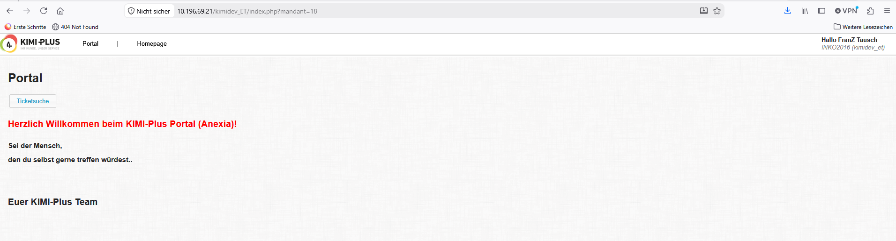.
- **Already analysed and fixed:** `tasks/07-implement-deployment-to-dev/12-session-reset-fix-analysis-and-plan.md` — the cause was not the cookie but `login.php` calling `session_unset()` on every load, discarding `$_SESSION["mandant"]` / `$_SESSION["kampId"]`. Fixed in `src-dev/original-src/web/htdocs/kimidev_ET/login.php` and `src-dev/original-src/web/htdocs/kimidev_ET/index.php`, committed as `823fda7` and deployed to the dev server.
- **The 23 Aug message does not raise it again.** More than that, his own 23 Aug screenshot  shows him inside `https://10.196.69.21/kimidev_ET/index.php?site=ticketsuch&s=0` with `OKO (kimidev_et)` displayed next to his name — i.e. the campaign survived and the search mask is reachable. The single open checklist item in `tasks/07-implement-deployment-to-dev/12-session-reset-fix-analysis-and-plan.md` ("(Optional) reconfirm in Franz's Firefox once he's back on the test env") can be treated as met, subject to Franz confirming it explicitly.

---

## P6 — Franz's process requests (not defects)

- He has entered his answers into the shared Google Doc — see `docs/16-additional-feedback-from-franz/google-doc-preexisting-issues-with-franz-answers.md` for the downloaded copy including all five answers. Example screenshot: 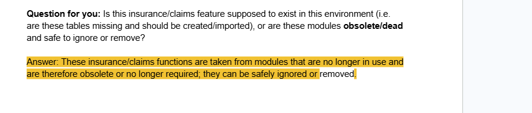.
- He asks for an **alignment meeting with Viktar before the test round proper starts** — *"Bitte um Prüfung und Rückmeldung und auch ob es einen Abstimmtermin geben kann"*, and from 19 Aug: *"Ich bitte daher um einen Terminvorschlag. Bitte immer Nachmittags"* (**afternoons only**). Reasons he gives: open questions about the database state, and the length of the question list in the Google Doc.
